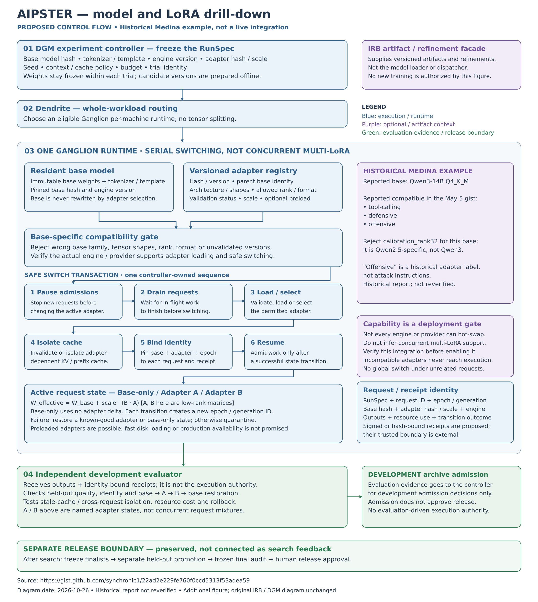

# AIPSTER

## Live demo (verified 2026-10-31)

**Working build:** [https://aipster.net/](https://aipster.net/) — deployed commit
[`d1de902`](https://github.com/synchronic1/AIPSTER/commit/d1de902eb90067459615714941ea048f719d9edd)
(site revision `2026-10-29.2`, per [deployment.json](https://aipster.net/deployment.json)).
Screenshots below are captured from that build on 2026-10-31. Repository `main`
has since advanced; unmerged work is listed under “Not in this build”.
Provenance (2026-10-31): `deployment.json`’s `git_commit` is the build’s
`GITHUB_SHA` — the deployed source. `release.json`’s `source_commit` (`25bf2ac`)
pins the messaging source (“User-approved product direction, 2026-10-26”), not the
deployment. `auth_deployed: false` in both files is a hardcoded placeholder
asserted by CI (`website/scripts/build.mjs`, `check.mjs`); it measures nothing live.

1. Open the landing page: product direction, research diagrams, the Meta Muse
   Worldwide Hackathon sponsor strip, and a Sign in entry point.

   

2. Choose Sign in → [`/app`](https://aipster.net/app): GitHub OAuth and a seeded
   demo login. Verified live without completing a sign-in: the OAuth handshake
   redirects to `github.com`, the demo endpoint validates input, and
   unauthenticated API calls return `401`. No authorized test identity was
   available, so signed-in screens are not shown or claimed.
   An OAuth-start redirect and anonymous `401`s prove endpoint shapes only — not
   completed sign-in, callback, session, authorized dashboard use, or logout.
   Recorded tension: the landing page carries the CI-enforced sentence “User login
   is not enabled on this public site.” while the auth endpoints above respond live;
   this pass documents both without ruling which is authoritative.

   

Mobile: no document overflow at 320–1440px (measured 2026-10-31);
see [viewport evidence](docs/demo/VIEWPORTS.md).

3. No recorded video exists yet: follow the [60–90 second shot list](docs/demo/SHOT-LIST.md).
   Owner action: record with an authorized test identity, upload, and link it here.

**In this build:** landing page, research and LoRA diagrams, `/app` sign-in shell
(GitHub OAuth handshake + demo-login endpoint, handshake shapes verified),
authenticated API boundary (`401` without a session), federation UI shell labeled
fixture-only with no live peers, DGM fixture preview shipped flag-gated and off by
default, local-worker installer docs.
**Not in this build:** model/adapter catalog (open
[PR #50](https://github.com/synchronic1/AIPSTER/pull/50), under review), live inference,
paid compute, billing, real peer federation.

**Three separate surfaces:** this Cloudflare web app; the local gateway console (a
`localhost` preview in the private Ganglion repository, fake-backed); and the
standalone Python DGM harness (separate local work, not deployed here).

**Meta:** this demo pass verified endpoint shapes only and makes no claim about model
usage. The evidence audit
([`docs/META-MODEL-USAGE.md`](https://github.com/synchronic1/AIPSTER/blob/0795de120aab41a8ddaa54d1c50ee3ec0d97f347/docs/META-MODEL-USAGE.md),
branch `muse/meta-model-usage`, base `main @ ba707e9`) reports no verified Meta model
inference: the job API returns `501 INFERENCE_DISABLED`, the native engine adapter is
unqualified, the running worker is mock, and inventoried operator weights are non-Meta.
It includes a bounded procedure for checking the reported usage further and does not
cover the unmerged catalog lane. Source files carry a `Built with Meta Muse` authorship
comment; the landing page names Meta among its hackathon sponsors.

## Install the standalone local worker

The [local-worker quickstart](local-worker/README.md) installs the included public
Dendrite source with pinned dependencies and a model-free mock health check.
No private repository access is required. This does not connect or enable AIPSTER
jobs; real execution remains gated. Project-owned code is licensed under
[Apache-2.0](LICENSE); see [NOTICE](NOTICE) for scope and third-party exclusions.

AIPSTER is a planned research system for running bounded, evidence-driven experiments on AI workflows. It combines IRB refinement infrastructure with an external trusted Darwin Gödel Machine (DGM) controller and archive, short Karpathy-style experiment loops, and optional JEV decision advice.

The design keeps experiments within explicit budgets and requires recorded evidence, independent evaluation, and promotion gates before promoting a change. Planned distributed inference routes whole workloads across machines; it does not split a model across them.

The offline scaffold — a separate local-only `stack/` repository with no remote and
no public source link, not the Cloudflare build above — has tested selection,
probability, budget, and event controls. Live self-improvement, full JEV integration, runner containment, and production deployment have not been demonstrated. This repository documents the proposed direction; it makes no claim of frontier results.

**Proposed architecture**

[View the editable SVG](assets/IRB-DGM-JEV-component-flow.svg)

## Model and LoRA drill-down

The proposed runtime keeps base weights resident and selects compatible, versioned LoRA adapters through a serial, request-safe switching sequence. This is not a claim of verified concurrent multi-LoRA serving; the Medina example is historical and has not been reverified.

[View the editable model/LoRA SVG](assets/AIPSTER-model-LoRA-drilldown.svg)

Conceptual design and offline scaffold work predate this public documentation repository. Publication dates do not establish when that earlier work occurred.
