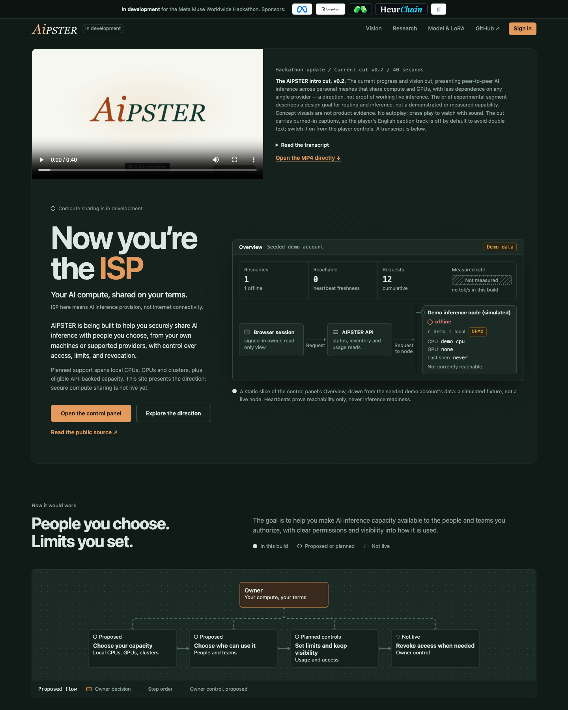
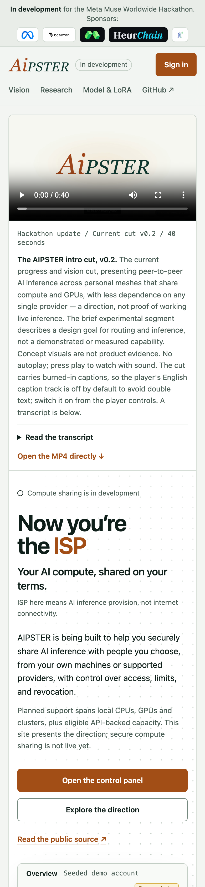
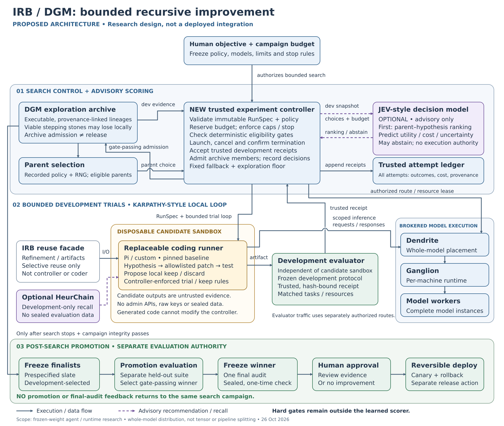
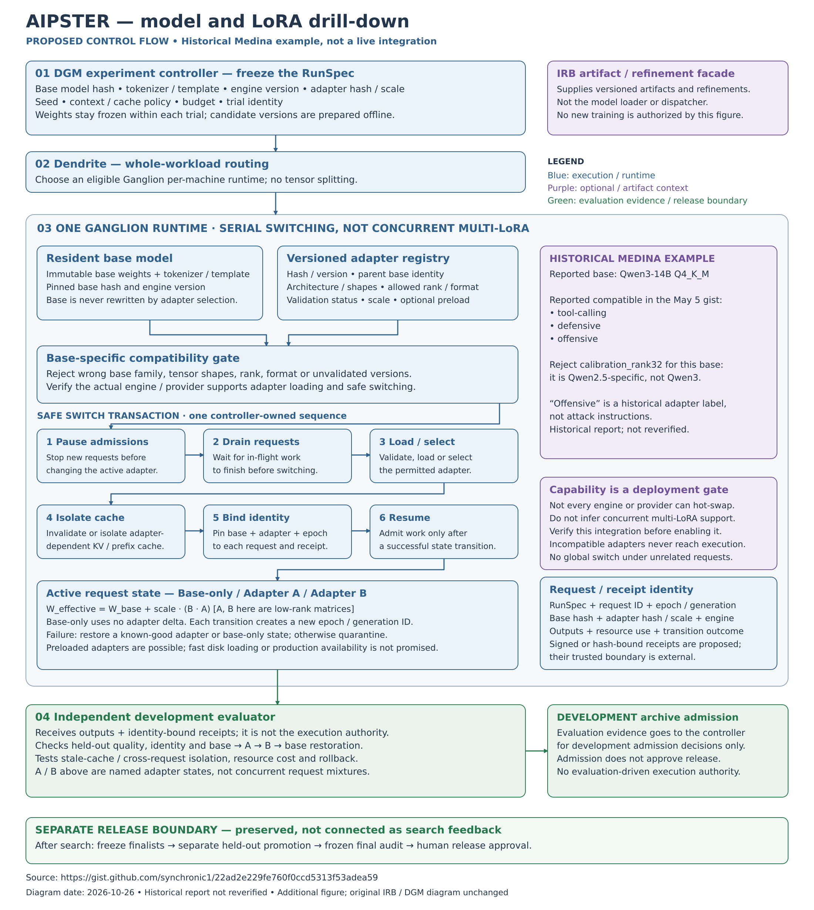

# AIPSTER

## The site

What the landing page at [aipster.net](https://aipster.net/) looks like with the
current design: the intro video, the hero with a static slice of the control
panel, and the "How it would work" diagram. Captured 2026-11-05 from a local build
of commit `5a09cf4` with motion settled; the landing page files are unchanged
through `f5b4572`, the build live at aipster.net on 2026-11-05. The Overview slice
is the seeded demo account, not live data.

## Live demo (verified 2026-10-31)

**Working build:** [https://aipster.net/](https://aipster.net/). Per the release
owner's check at 2026-10-31 21:39 UTC, production served commit
[`06d90bd`](https://github.com/synchronic1/AIPSTER/commit/06d90bdb3cb82a1b15e5b1890992d7cdcc7caff2)
(site revision `2026-10-29.2`,
[deploy run 41244040453](https://github.com/synchronic1/AIPSTER/actions/runs/41244040453)).
Check [deployment.json](https://aipster.net/deployment.json) for the current commit.
**Historical capture:** the screenshots and viewport measurements below were taken
on 2026-10-31 (time of day not recorded) from the build deployed then,
[`d1de902`](https://github.com/synchronic1/AIPSTER/commit/d1de902eb90067459615714941ea048f719d9edd).
`d1de902..06d90bd` includes control-panel (`app.js`) changes, so the current
`/app` can differ from those screenshots. Unmerged work is listed under
“Not in this build”.
Provenance (2026-10-31): `deployment.json`’s `git_commit` is the build’s
`GITHUB_SHA` — the deployed source. `release.json`’s `source_commit` (`25bf2ac`)
pins the messaging source (“User-approved product direction, 2026-10-26”), not the
deployment. `auth_deployed: false` in both files is a hardcoded placeholder
asserted by CI (`website/scripts/build.mjs`, `check.mjs`); it measures nothing live.

1. Open the landing page: product direction, research diagrams, the Meta Muse
   Worldwide Hackathon sponsor strip, and a Sign in entry point.

   

2. Choose Sign in → [`/app`](https://aipster.net/app): GitHub OAuth and a seeded
   demo login. Verified live without completing a sign-in: the OAuth handshake
   redirects to `github.com`, the demo endpoint validates input, and
   unauthenticated API calls return `401`. No authorized test identity was
   available, so signed-in screens are not shown or claimed.
   An OAuth-start redirect and anonymous `401`s prove endpoint shapes only — not
   completed sign-in, callback, session, authorized dashboard use, or logout.
   Recorded tension: the landing page carries the CI-enforced sentence “User login
   is not enabled on this public site.” while the auth endpoints above respond live;
   this pass documents both without ruling which is authoritative.

   

Mobile: no document overflow at 320–1440px (measured 2026-10-31 on d1de902);
see [viewport evidence](docs/demo/VIEWPORTS.md).

3. Watch the current hackathon intro cut (40 seconds, v0.2) on the
   [homepage](https://aipster.net/#hackathon-video), or open the
   [direct MP4](https://aipster.net/assets/aipster-intro-v0-2.mp4).

   

   The cut is a progress and vision piece: concept visuals, not proof of
   working live inference or measured gains. Captions and a transcript are on
   the homepage. The published copy is a 720p web encode of the owner's
   40-second `aipster-intro_v0.2_captioned.mp4`, compressed to stay within the
   site's 10 MiB per-asset cap (SHA-256
   `3002f79637332513c2cc60faf2610fab7e033c697f11552ba5a8282dde0f7ee7`).

**In this build:** landing page, the current hackathon intro video with captions,
research and LoRA diagrams, `/app` sign-in shell
(GitHub OAuth handshake + demo-login endpoint, handshake shapes verified),
authenticated API boundary (`401` without a session), federation UI shell labeled
fixture-only with no live peers, DGM fixture preview shipped flag-gated and off by
default, Fabric adviser
([PR #58](https://github.com/synchronic1/AIPSTER/pull/58)) shipped flag-gated and off
by default (fixture-first; per the release owner's 2026-10-31 check of
production secret names, no provider key was configured), local-worker installer docs.
**Not in this build:** model/adapter catalog (open
[PR #50](https://github.com/synchronic1/AIPSTER/pull/50), under review), live inference,
paid compute, billing, real peer federation.

**Three separate surfaces:** this Cloudflare web app; the local gateway console (a
`localhost` preview in the private Ganglion repository, fake-backed); and the
standalone Python DGM harness (separate local work, not deployed here).

**Meta:** this demo pass verified endpoint shapes only and makes no claim about model
usage. The evidence audit
([`docs/META-MODEL-USAGE.md`](https://github.com/synchronic1/AIPSTER/blob/0795de120aab41a8ddaa54d1c50ee3ec0d97f347/docs/META-MODEL-USAGE.md),
merged via [PR #56](https://github.com/synchronic1/AIPSTER/pull/56); audit base `main @ ba707e9`) reports no verified Meta model
inference: the job API returns `501 INFERENCE_DISABLED`, the native engine adapter is
unqualified, the running worker is mock, and inventoried operator weights are non-Meta.
It includes a bounded procedure for checking the reported usage further and does not
cover the unmerged catalog lane. Source files carry a `Built with Meta Muse` authorship
comment; the landing page names Meta among its hackathon sponsors.

## How it would work

Owners would choose their capacity, choose who can use it, set limits and keep
visibility, and revoke access when needed. The first two steps are proposed, the
third is planned controls, and revocation is not live. Secure sharing is not live yet.

## Personal meshes

Each owner keeps a mesh of their own machines and decides which capacity to offer,
and to whom. Concept illustration: the drawing illustrates the proposed design, not
live traffic. Lanes between meshes are architectural; secure compute sharing is not
live yet. Machine state is drawn by shape: online is a filled disc, stale a half
disc, offline a hollow diamond and unknown a dashed ring; copper rings mark capacity
an owner chooses to share.

## Install the standalone local worker

The [local-worker quickstart](local-worker/README.md) installs the included public
Dendrite source with pinned dependencies and a model-free mock health check.
No private repository access is required. This does not connect or enable AIPSTER
jobs; real execution remains gated. Project-owned code is licensed under
[Apache-2.0](LICENSE); see [NOTICE](NOTICE) for scope and third-party exclusions.

AIPSTER is a planned research system for running bounded, evidence-driven experiments on AI workflows. It combines IRB refinement infrastructure with an external trusted Darwin Gödel Machine (DGM) controller and archive, short Karpathy-style experiment loops, and optional JEV decision advice.

The design keeps experiments within explicit budgets and requires recorded evidence, independent evaluation, and promotion gates before promoting a change. Planned distributed inference routes whole workloads across machines; it does not split a model across them.

The offline scaffold — a separate local-only `stack/` repository with no remote and
no public source link, not the Cloudflare build above — has tested selection,
probability, budget, and event controls. Live self-improvement, full JEV integration, runner containment, and production deployment have not been demonstrated. This repository documents the proposed direction; it makes no claim of frontier results.

**Proposed design**

No promotion or final-audit feedback returns to the same search campaign.

**Fig. 1: proposed IRB / DGM component flow** (the published figure, with its
original conceptual labels)

[View the editable SVG](assets/IRB-DGM-JEV-component-flow.svg)

## Model and LoRA drill-down

The proposed runtime keeps base weights resident and selects compatible, versioned LoRA adapters through a serial, request-safe switching sequence. This is not a claim of verified concurrent multi-LoRA serving; the Medina example is historical and has not been reverified.

[View the editable model/LoRA SVG](assets/AIPSTER-model-LoRA-drilldown.svg)

Conceptual design and offline scaffold work predate this public documentation repository. Publication dates do not establish when that earlier work occurred.
