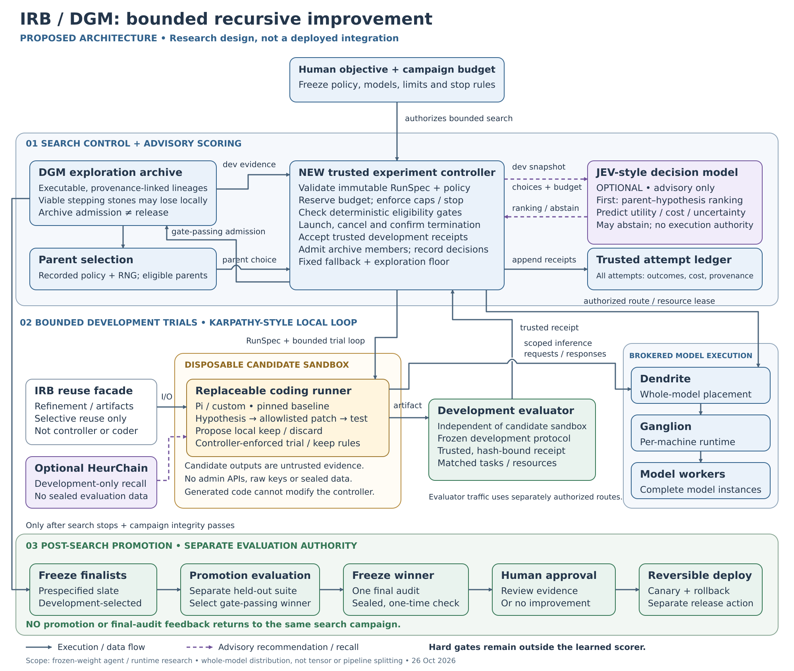

# AIPSTER

AIPSTER is a planned research system for running bounded, evidence-driven experiments on AI workflows. It combines IRB refinement infrastructure with an external trusted Darwin Gödel Machine (DGM) controller and archive, short Karpathy-style experiment loops, and optional JEV decision advice.

The design keeps experiments within explicit budgets and requires recorded evidence, independent evaluation, and promotion gates before promoting a change. Planned distributed inference routes whole workloads across machines; it does not split a model across them.

The offline scaffold has tested selection, probability, budget, and event controls. Live self-improvement, full JEV integration, runner containment, and production deployment have not been demonstrated. This repository documents the proposed direction; it makes no claim of frontier results.

**Proposed architecture**

[View the editable SVG](assets/IRB-DGM-JEV-component-flow.svg)

Conceptual design and offline scaffold work predate this public documentation repository. Publication dates do not establish when that earlier work occurred.
